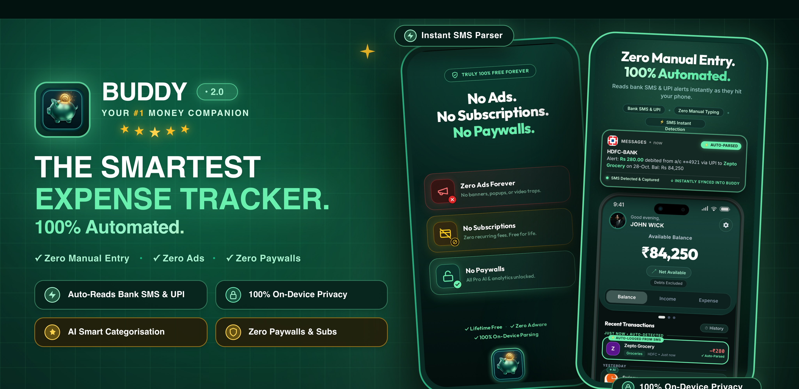
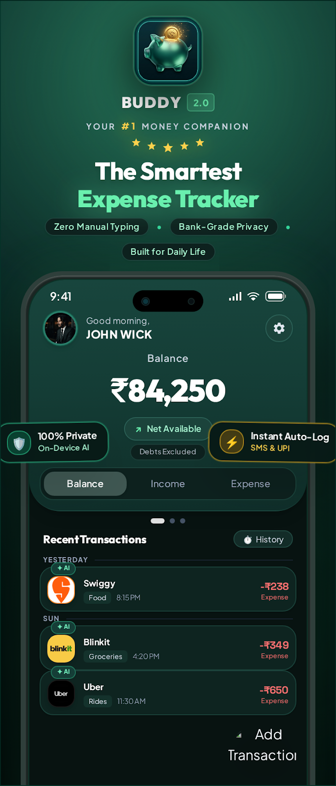
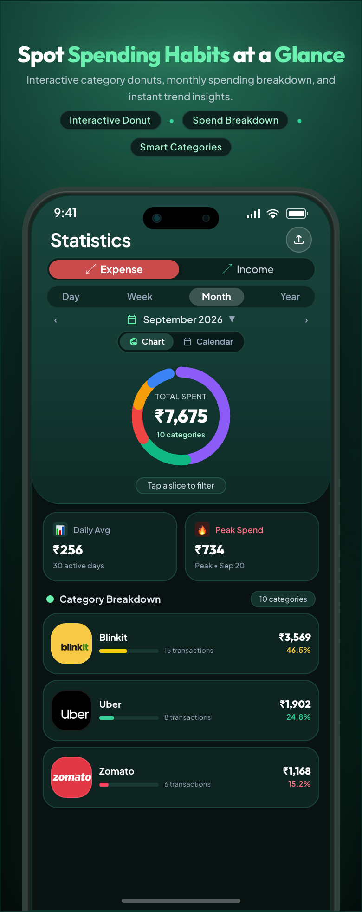
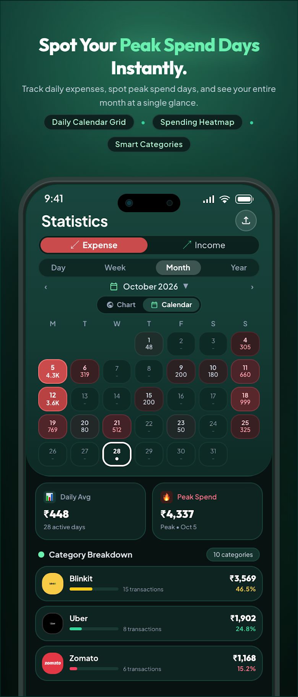
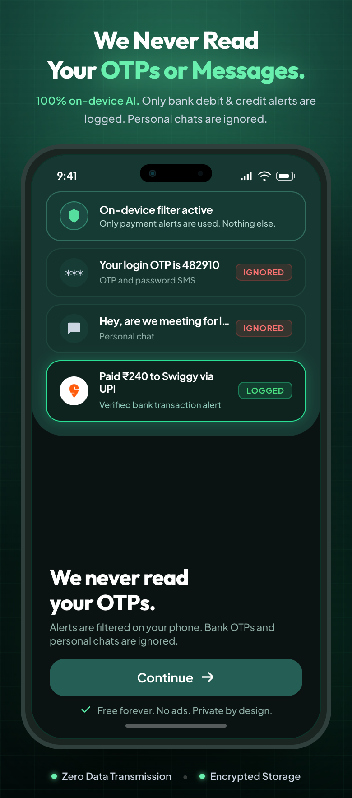
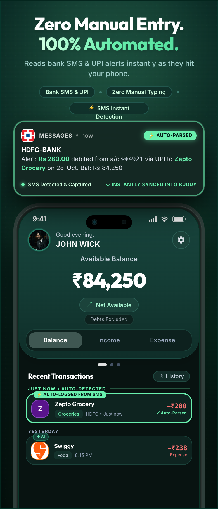
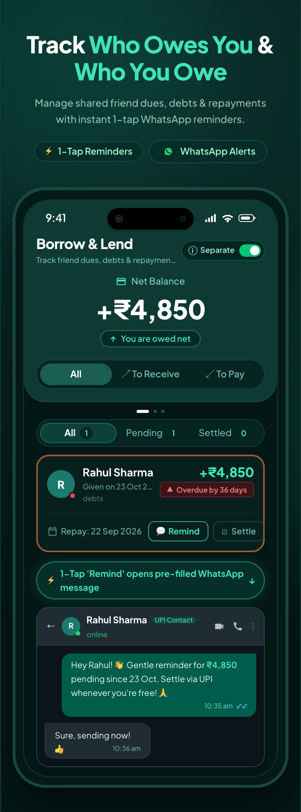
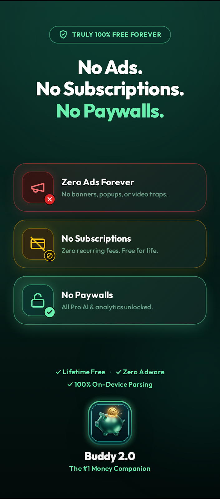
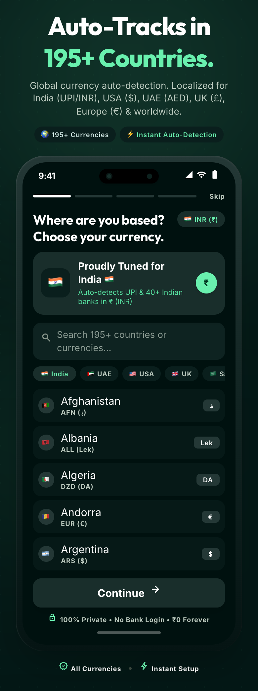
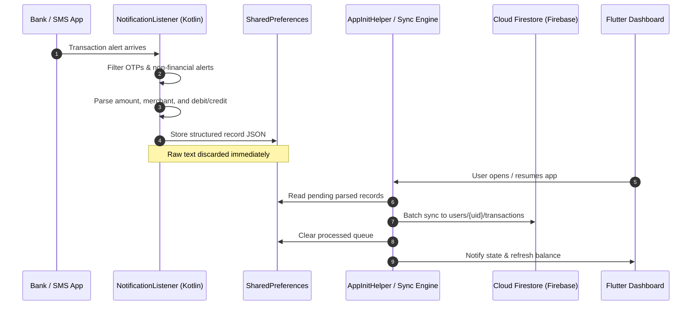

<div align="center">

  

  # 💰 Buddy - Smart Expense Tracker

  <p align="center">
    <strong>Automated, intelligent personal finance management powered by on-device bank SMS detection and Firebase cloud sync.</strong>
  </p>

  <p align="center">
    <a href="https://faysarukattil.github.io/buddy_2.0/"></a>
    <a href="https://play.google.com/store/apps/details?id=com.faysarukattil.buddy"></a>
    <a href="https://github.com/FaysArukattil/buddy_2.0"></a>
  </p>

  <p align="center">
    
    
    
    
    
  </p>

  <p align="center">
    <a href="#-about">About</a> •
    <a href="#-app-screenshots">Screenshots</a> •
    <a href="#-key-features">Features</a> •
    <a href="#-data-architecture--privacy">Data & Privacy</a> •
    <a href="#-how-it-works">How It Works</a> •
    <a href="#️-installation--setup">Setup</a> •
    <a href="#-legal--compliance">Legal</a>
  </p>

</div>

---

## 📖 About

**Buddy** is an intelligent personal finance tracker built with **Flutter**, designed to eliminate tedious manual transaction entry. 

Using native Android background intelligence, Buddy listens for incoming transaction notifications (bank SMS and payment push alerts), parses the details **locally in memory on your phone**, and transforms them into organized expense budgets, debt ledgers, and visual financial analytics. 

For authenticated users, the structured records are synced to **Google Firebase Cloud Firestore** for seamless backup across devices. Buddy also offers a 100% offline **Guest Mode** for users who prefer local-only storage.

> **📢 Notice regarding Open-Source Status:**  
> Buddy is currently an open-source project hosted on GitHub to provide complete architectural and privacy transparency. Please note that features, backend infrastructure, distribution, and licensing terms may evolve in future releases as the project matures.

---

## 📸 App Screenshots

<div align="center">
  <table>
    <tr>
      <td width="25%" align="center">
        
        <br><b>📊 Live Dashboard</b><br>
        <sub>Real-time balances, income & expense summaries</sub>
      </td>
      <td width="25%" align="center">
        
        <br><b>⚡ Smart Auto-Detection</b><br>
        <sub>Instant parsing of bank SMS and push alerts</sub>
      </td>
      <td width="25%" align="center">
        
        <br><b>🤝 Borrow & Lend</b><br>
        <sub>Dedicated debt tracking & repayment ledger</sub>
      </td>
      <td width="25%" align="center">
        
        <br><b>📈 Visual Analytics</b><br>
        <sub>Category breakdown & monthly burn rate</sub>
      </td>
    </tr>
    <tr>
      <td width="25%" align="center">
        
        <br><b>🔍 Search & Filter</b><br>
        <sub>Instant-find by date, merchant, or category</sub>
      </td>
      <td width="25%" align="center">
        
        <br><b>🌍 Global Currencies</b><br>
        <sub>Custom rules across 50+ world nations</sub>
      </td>
      <td width="25%" align="center">
        
        <br><b>🎨 Theme Control</b><br>
        <sub>Deep-emerald dark and light palettes</sub>
      </td>
      <td width="25%" align="center">
        
        <br><b>🛡️ User Control</b><br>
        <sub>Granular settings & 1-tap account deletion</sub>
      </td>
    </tr>
  </table>
</div>

---

## 🎯 Key Features

### ⚡ Automated Bank Transaction Detection
- Native Android `NotificationListenerService` listens for incoming bank alerts.
- High-precision regex engine extracts amount, merchant name, currency, date, and transaction type (Debit/Credit).
- Zero battery drain: runs in native Kotlin without keeping the Dart VM alive unnecessarily.
- Automated deduplication with hash comparison prevents double-counting transactions.

### 🤝 Borrow & Lend (Debts) Ledger
- Track money you owe to others and money others owe to you.
- Associate debts with phone contacts and target due dates.
- Record partial payments and track net balance across all counterparties.

### ☁️ Secure Firebase Cloud Storage
- Sign in with **Google Sign-In** or **Email/Password**.
- Once parsed, structured transactions, categories, and debts sync to **Google Cloud Firestore**.
- Complete data isolation enforced by Firebase Security Rules (`request.auth.uid == userId`).
- Full **Guest Mode** supported for 100% offline, local-only usage.

### 📊 Deep Analytics & Reporting
- Interactive category charts powered by `fl_chart`.
- Breakdown by Daily, Weekly, Monthly, and Yearly spend windows.
- One-tap export to clean, printable **PDF Statements**.

### 🌍 Global Multi-Currency Support
- Built-in recognition rules for major banks across 50+ countries (India, USA, UK, UAE, Saudi Arabia, Canada, Europe, etc.).
- Universal fallback engine ensures foreign currency transactions are parsed accurately anywhere in the world.

### 🗑️ Complete Data Ownership & Instant Account Deletion
- 1-tap account deletion directly inside the app (`Settings > Account > Delete account`).
- Immediately purges your user profile, all Firestore subcollections (transactions, categories, debts), and Firebase Auth account.

---

## 🔒 Data Architecture & Privacy

```
                                  [ Bank SMS / App Notification ]
                                                 │
                                                 ▼
                             ┌───────────────────────────────────────┐
                             │  Native Kotlin Background Listener    │
                             │  (On-Device Memory Parsing in < 2ms)  │
                             └───────────────────────────────────────┘
                                                 │
                                  Raw text discarded immediately
                                  Only structured figures kept
                                                 │
                                                 ▼
                             ┌───────────────────────────────────────┐
                             │    Local Storage (SharedPreferences)  │
                             └───────────────────────────────────────┘
                                                 │
                                           App Resumes
                                                 │
                                                 ▼
                             ┌───────────────────────────────────────┐
                             │        Flutter App Core Engine        │
                             └───────────────────────────────────────┘
                                        │                 │
                    [If Guest Mode]     │                 │   [If Signed In]
                                        ▼                 ▼
                             ┌──────────────────┐  ┌─────────────────────────────┐
                             │  Local SQLite    │  │  Google Cloud Firestore     │
                             │  (On-Device Only)│  │  (/users/{uid}/collections) │
                             └──────────────────┘  └─────────────────────────────┘
```

1. **On-Device Parsing**: Notification and SMS texts are parsed strictly in local memory. Raw notification bodies, personal text messages, and OTPs are **never** uploaded to any external server.
2. **Cloud Storage**: For users who sign in, the resulting parsed transaction amounts, categories, and debts are stored in **Google Cloud Firestore** to enable cross-device synchronization and backup.
3. **Data Protection**: Database access is protected by Firebase Security Rules enforcing user authentication (`request.auth.uid == userId`).

---

## 🚀 How It Works

### Sequence Diagram



---

## 🛠️ Installation & Setup

### Prerequisites

- [Flutter SDK](https://flutter.dev/docs/get-started/install): `>= 3.9.2`
- [Dart SDK](https://dart.dev/get-dart): `>= 3.9.2`
- Android Studio / VS Code with Flutter extension
- Android device or emulator running **API Level 21+**
- A [Firebase](https://firebase.google.com/) project (with Auth and Firestore enabled)

### Steps

1. **Clone the repository:**
   ```bash
   git clone https://github.com/FaysArukattil/buddy_2.0.git
   cd buddy_2.0
   ```

2. **Install Flutter packages:**
   ```bash
   flutter pub get
   ```

3. **Firebase Configuration:**
   - Create a project on the [Firebase Console](https://console.firebase.google.com/).
   - Add an Android app with package name `com.faysarukattil.buddy`.
   - Download `google-services.json` and place it in `android/app/`.
   - In Firebase Console, enable:
     - **Authentication**: Enable Google Sign-In and Email/Password.
     - **Cloud Firestore**: Enable in production or test mode.
   - For Google Sign-In, add your debug and release SHA-1 certificate fingerprints to your Firebase Project Settings.

4. **Run the Application:**
   ```bash
   flutter run
   ```

5. **Grant Notification Access:**
   - On the first launch, follow the onboarding prompt or navigate to Android **Settings → Notification Access**.
   - Enable **Buddy** so the background service can receive bank transaction alerts.

---

## 📁 Project Structure

```
lib/
├── main.dart                          # App entrypoint & service orchestration
├── firebase_options.dart              # Generated Firebase configuration
│
├── features/                          # Feature modules (e.g., Onboarding)
├── models/                            # Data models (Transaction, Category, Debt)
├── parsing/                           # Global bank parser & country rule registries
├── repositories/                      # Data layer & abstraction
├── services/                          # Business logic & integrations
│   ├── auth_service.dart              # Firebase Auth, Google Sign-In, re-auth & deletion
│   ├── firestore_service.dart         # Cloud Firestore CRUD & offline cache
│   ├── debt_service.dart              # Borrow & lend ledger logic
│   ├── legal_service.dart             # Privacy & Terms launcher
│   ├── notification_service.dart      # Bridge to native notification listener
│   ├── currency_service.dart          # Currency resolution & Firestore sync
│   └── app_init_helper.dart           # App startup & background-to-foreground sync
│
├── utils/                             # Theme colors, formatting, snackbars
└── views/                             # Presentation layer
    ├── screens/                       # Home, Statistics, Profile, Filtered lists
    └── widgets/                       # Settings modal, custom dialogs, cards
```

---

## 📜 Legal & Compliance

Buddy provides publicly hosted legal documentation deployed via GitHub Pages:

- 🌐 **[App Landing Page](https://faysarukattil.github.io/buddy_2.0/)**
- 🔒 **[Privacy Policy](https://faysarukattil.github.io/buddy_2.0/privacy.html)**
- 📄 **[Terms of Service](https://faysarukattil.github.io/buddy_2.0/terms.html)**
- 🗑️ **[Account & Data Deletion Guide](https://faysarukattil.github.io/buddy_2.0/delete-account.html)**

---

## 🤝 Contributing

Contributions, bug reports, and feature requests are welcome!

1. Fork the repository.
2. Create your feature branch (`git checkout -b feature/awesome-idea`).
3. Commit your changes (`git commit -m 'feat: add support for new bank format'`).
4. Push to the branch (`git push origin feature/awesome-idea`).
5. Open a Pull Request.

---

## 👨‍💻 Author

**Faysal Arukattil**  
- GitHub: [@FaysArukattil](https://github.com/FaysArukattil)  
- Email: [faysarukattil@gmail.com](mailto:faysarukattil@gmail.com)  
- Support the Project: [Buy Me a Chai ☕](https://buymeachai.in/faysarukattil)

---

<div align="center">
  <sub>Built with ❤️ using Flutter, Kotlin, and Firebase</sub>
</div>
